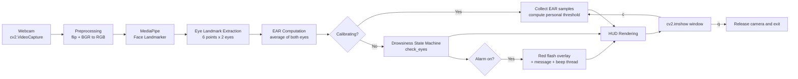
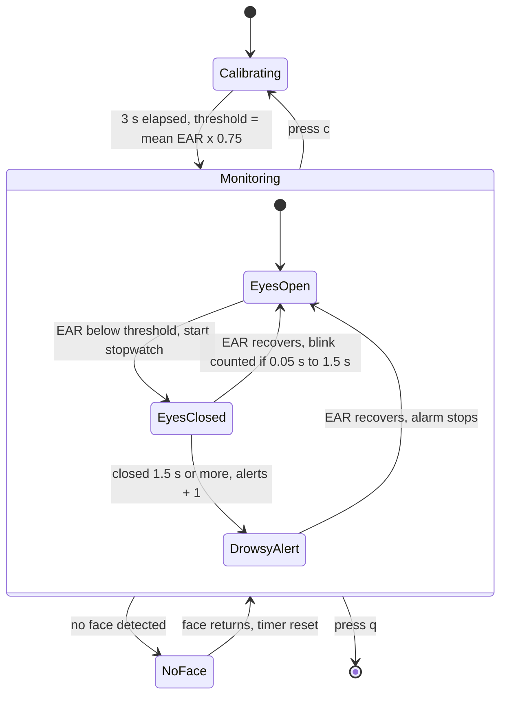

# 🚗 Real-Time Driver Drowsiness Detection Using Computer Vision

A real-time computer vision project that monitors a driver's eye movements through a webcam and detects potential drowsiness using **MediaPipe Face Landmarks, OpenCV, and Eye Aspect Ratio (EAR)**.

The system continuously analyzes eye openness, distinguishes normal blinking from prolonged eye closure, and triggers an audio-visual warning when signs of drowsiness are detected.

The project aims to demonstrate how computer vision can contribute to driver safety by identifying potential fatigue-related behavior in real time.

---

## 📌 Table of Contents

- [Project Overview](#-project-overview)
- [Problem Statement](#-problem-statement)
- [Project Objectives](#-project-objectives)
- [Key Features](#-key-features)
- [Technologies Used](#-technologies-used)
- [System Architecture](#-system-architecture)
- [How It Works](#-how-it-works)
- [Eye Aspect Ratio (EAR)](#-eye-aspect-ratio-ear)
- [System Workflow](#-system-workflow)
- [Drowsiness Detection Logic](#-drowsiness-detection-logic)
- [Project Structure](#-project-structure)
- [Installation and Setup](#-installation-and-setup)
- [How to Run](#-how-to-run)
- [Configuration Parameters](#-configuration-parameters)
- [Keyboard Controls](#-keyboard-controls)
- [On-Screen Display](#-on-screen-display)
- [Sample Output](#-sample-output)
- [Troubleshooting](#-troubleshooting)
- [Future Improvements](#-future-improvements)
- [Limitations](#-limitations)
- [Applications](#-applications)
- [Disclaimer](#-disclaimer)
- [Author](#-author)

---

## 📖 Project Overview

Driver fatigue is one of the important factors that can contribute to road accidents. Prolonged driving and insufficient rest can cause reduced alertness and slower reactions.

This project implements a **Real-Time Driver Drowsiness Detection System** using computer vision.

It captures live video through a webcam, detects facial landmarks using MediaPipe Face Landmarker, and calculates the Eye Aspect Ratio (EAR) to monitor whether the driver's eyes are open or closed.

The system includes an initial calibration phase that learns the user's normal open-eye EAR value. It then uses a personalized threshold to identify eye closure.

If the eyes remain closed for 1.5 seconds or longer, the system triggers a drowsiness alert with a flashing red visual warning and an audio beep.

## 🎯 Problem Statement

Driver fatigue can cause a loss of concentration and reduced reaction time.

Traditional monitoring methods may not continuously identify signs of reduced alertness.

The objective of this project is to develop a webcam-based computer vision system that:

- Monitors eye movements in real time.
- Identifies normal blinking behavior.
- Detects prolonged eye closure.
- Generates an immediate audio-visual warning.
- Provides a personalized eye-closure threshold through calibration.

## 🎯 Project Objectives

1. Implement real-time facial landmark detection.
2. Extract eye landmark coordinates using MediaPipe.
3. Calculate Eye Aspect Ratio (EAR).
4. Differentiate normal blinking from prolonged eye closure.
5. Implement automatic eye calibration.
6. Generate real-time drowsiness alerts.
7. Display eye-closure duration and detection statistics.

## ✨ Key Features

| Feature | Description |
|---|---|
| Real-Time Monitoring | Continuously monitors the user's eyes through a webcam. |
| Face Landmark Detection | Uses MediaPipe Face Landmarker to detect facial landmarks. |
| Eye Aspect Ratio | Calculates eye openness using six landmarks per eye. |
| Automatic Calibration | Learns the user's normal open-eye EAR during the initial 3 seconds. |
| Blink Detection | Counts short eye closures as normal blinks. |
| Drowsiness Detection | Detects prolonged eye closure lasting 1.5 seconds or more. |
| Audio Alert | Generates a beep when drowsiness is detected. |
| Visual Alert | Displays a flashing red warning on the screen. |
| Live Statistics | Displays EAR, blink count, alert count, and eye-closure duration. |
| No-Face Safety | Resets the eye-closure timer when no face is visible, avoiding false alarms. |
| Recalibration | Allows the user to recalibrate the system during operation. |

## 🛠 Technologies Used

| Technology | Purpose |
|---|---|
| Python 3.12 | Core programming language |
| OpenCV | Webcam access, image processing, and real-time visualization |
| MediaPipe (Tasks API) | Facial landmark detection (`face_landmarker.task`) |
| NumPy 1.26.4 | Numerical calculations and EAR computation |
| Matplotlib | EAR visualization and demonstration |
| Threading | Plays audio alerts without blocking video processing |
| Time | Tracks eye-closure duration and calibration time |
| Jupyter Notebook | Interactive development environment |

> **Note:** NumPy is pinned to `1.26.4` because NumPy 2.x caused compatibility conflicts with the OpenCV/MediaPipe stack used in this project.

## 🏗 System Architecture

### High-Level Pipeline



### Layered View

```text
+--------------------------------------------------------------+
|  PRESENTATION LAYER                                          |
|  OpenCV window | HUD text | progress bar | flashing overlay  |
+--------------------------------------------------------------+
|  DECISION LAYER                                              |
|  Calibration | Threshold | Blink / Drowsy state machine      |
|  (state dict, check_eyes(), reset_when_no_face())            |
+--------------------------------------------------------------+
|  FEATURE LAYER                                               |
|  Eye landmark selection | eye_aspect_ratio()                 |
+--------------------------------------------------------------+
|  PERCEPTION LAYER                                            |
|  MediaPipe FaceLandmarker (face_landmarker.task, float16)    |
+--------------------------------------------------------------+
|  INPUT LAYER                                                 |
|  Webcam via cv2.VideoCapture                                 |
+--------------------------------------------------------------+
   Side channel: play_alarm() -> background thread -> OS beep
```

### Components

| Component | Responsibility |
|---|---|
| `cv2.VideoCapture` | Captures frames from the webcam (`CAMERA_NUMBER`) |
| `FaceLandmarker` | Detects one face and returns facial landmarks |
| `RIGHT_EYE` / `LEFT_EYE` | Landmark index lists in the order the EAR formula expects |
| `eye_aspect_ratio(p)` | Converts six eye points into one openness score |
| `state` dictionary | Holds `closed_since`, `blinks`, `alerts`, `alarm_on` |
| `check_eyes(ear, now, threshold)` | Updates state and returns seconds the eyes have been closed |
| `reset_when_no_face()` | Clears the stopwatch and alarm when no face is detected |
| `play_alarm()` | Plays a beep on a daemon thread so the video never freezes |
| Main loop | Capture, detect, calibrate or decide, draw, alert, handle keys |

### State Machine



## ⚙️ How It Works

The project follows these steps:

**1. Webcam Initialization**

- OpenCV accesses the default webcam.
- Video frames are captured continuously.
- Frames are flipped horizontally to provide a mirror-like view.

**2. Face Landmark Detection**

- MediaPipe Face Landmarker detects facial landmarks.
- The system processes one face at a time.
- Facial landmark coordinates are extracted.

**3. Eye Landmark Extraction**

Six specific landmark points are selected around each eye.

- Right Eye: `[33, 160, 158, 133, 153, 144]`
- Left Eye: `[362, 385, 387, 263, 373, 380]`

**4. EAR Calculation**

The Eye Aspect Ratio is calculated independently for both eyes.

The average EAR is used to estimate eye openness.

**5. Automatic Calibration**

- During the initial 3 seconds, the system collects EAR values.
- It calculates the average EAR.
- A personalized threshold is established using 75% of the average calibration EAR.

**6. Blink and Drowsiness Detection**

- Short eye closures are counted as normal blinks.
- If the eyes remain closed for 1.5 seconds or longer, a drowsiness alert is triggered.

**7. Audio-Visual Alert**

- A beep sound is generated.
- A flashing red overlay appears.
- A warning message is displayed.

## 👁 Eye Aspect Ratio (EAR)

The Eye Aspect Ratio (EAR) is a mathematical measurement used to estimate eye openness from facial landmarks.

It measures the relationship between the vertical and horizontal distances of the eye.

### EAR Formula

$$
EAR = \frac{\|P_2-P_6\|+\|P_3-P_5\|}{2\|P_1-P_4\|}
$$

Where:

- P1 and P4 represent the horizontal eye corners.
- P2 and P3 represent the upper eyelid landmarks.
- P5 and P6 represent the lower eyelid landmarks.

```text
        P2    P3
   P1  .--.--.--.  P4
        .      .
        P6    P5
```

### How EAR Works

- **Open Eyes:** Higher EAR value.
- **Closed Eyes:** Lower EAR value.
- **Prolonged Eye Closure:** Indicates a potential drowsiness event.

The system uses the average EAR of both eyes to improve monitoring.

## 🔄 System Workflow

```text
             Start
               |
               v
       Initialize Webcam
               |
               v
       Capture Video Frame
               |
               v
       Detect Facial Landmarks
               |
          Face Found?
          /         \
        No           Yes
        |             |
        v             v
   Reset Eye     Extract Eye
   Tracking      Landmarks
                      |
                      v
                Calculate EAR
                      |
                      v
                Calibration
                 (3 Seconds)
                      |
                      v
              Calculate Personal
                  Threshold
                      |
                      v
               Monitor Eye State
                      |
               Eyes Closed?
                 /       \
               No         Yes
               |           |
               v           v
          Count Short   Track Closure
           Blinks        Duration
                           |
                           v
                  Closure >= 1.5 sec?
                     /        \
                   No          Yes
                   |            |
                   v            v
                Continue    Trigger Alert
                              |
                       Audio + Visual
                           Warning
                              |
                              v
                         Next Frame
```

## 🧠 Drowsiness Detection Logic

The project uses a time-based eye-closure detection approach.

| Condition | System Behavior |
|---|---|
| EAR above threshold | Eyes considered open |
| Eyes closed for less than 0.05 seconds | Ignored as noise |
| Eyes closed for 0.05 to less than 1.5 seconds | Counted as a blink when eyes reopen |
| Eyes closed for 1.5 seconds or more | Drowsiness alert |

The system maintains:

- `closed_since`: Records when eye closure begins.
- `blinks`: Counts normal short-duration eye closures.
- `alerts`: Tracks the number of drowsiness alerts.
- `alarm_on`: Maintains the current alarm state.

A separate thread is used for playing the audio alert so that the webcam video does not freeze while the beep is playing.

## 📁 Project Structure

```text
.
├── Drawsinees_detection_Live.ipynb   # Complete project: setup, logic and live app
├── face_landmarker.task              # MediaPipe model (auto-downloaded on first run)
└── README.md                         # Project documentation
```

### Notebook Cell Overview

| Cell | Purpose |
|---|---|
| Environment check | Verifies the Python interpreter and pins NumPy 1.26.4 |
| Imports | Installs and imports MediaPipe, OpenCV, NumPy, Matplotlib |
| EAR demo | Defines `eye_aspect_ratio()` and plots open vs. closed eyes |
| Settings | All configurable constants |
| Model download | Fetches `face_landmarker.task` if missing |
| Detector setup | Creates `FaceLandmarker` and defines eye landmark indices |
| Detection logic | `state`, `check_eyes()`, `reset_when_no_face()`, `play_alarm()` |
| Live loop | Webcam capture, calibration, detection, HUD, alerts, key handling |

## ▶️ How to Run

1. Open `Drawsinees_detection_Live.ipynb` in Jupyter Notebook.
2. Run all cells from top to bottom. The face model downloads automatically on the first run (internet needed once).
3. The final cell opens the webcam window.
4. **Calibration:** keep your eyes open and look at the camera for about 3 seconds.
5. Monitoring starts automatically. Close your eyes for 1.5 seconds or more to test the alarm.
6. Click on the video window and press `q` to quit.

## 🎛 Configuration Parameters

The following parameters are defined in the notebook and can be adjusted:

| Parameter | Default Value | Purpose |
|---|---:|---|
| `DROWSY_SECONDS` | 1.5 | Eye-closure duration required to trigger an alert. |
| `MIN_BLINK_SECONDS` | 0.05 | Minimum eye-closure duration counted as a blink. |
| `CALIBRATION_SECONDS` | 3 | Initial calibration duration. |
| `THRESHOLD_FRACTION` | 0.75 | Fraction of average calibration EAR used as the closure threshold. |
| `DEFAULT_EAR_THRESHOLD` | 0.21 | Fallback EAR threshold if calibration fails. |
| `CAMERA_NUMBER` | 0 | Default webcam index. |

**Tuning tips**

- Too many false alarms: increase `DROWSY_SECONDS` or lower `THRESHOLD_FRACTION`.
- Closures not detected or alarm too slow: lower `DROWSY_SECONDS` or raise `THRESHOLD_FRACTION`.

## ⌨️ Keyboard Controls

| Key | Function |
|---|---|
| `q` | Quit the detection system. |
| `c` | Restart eye calibration. |

> Click on the video window first so it receives key presses.

## 🖥 On-Screen Display

| Element | Meaning |
|---|---|
| `CALIBRATING... eyes open, look at camera` | Calibration in progress |
| `EAR: x.xx (closed below y.yy)` | Live EAR and personal threshold |
| `Blinks: N   Alerts: N` | Session counters |
| Green dots | The 12 tracked eye landmarks |
| Progress bar | Green (below 60%), orange (below 100%), red (alarm reached) |
| `Eyes closed: x.xs / 1.5s` | Current closure time vs. alarm limit |
| `No face found` | No face detected; timers reset, no false alarm |
| Flashing red screen | `DROWSINESS ALERT!` with `WAKE UP! PULL OVER AND REST`, beep every second |

## 📋 Sample Output

```text
Webcam started. Click the video window, then press 'q' to quit, 'c' to recalibrate.
Calibration done. Your eye-closed limit (EAR) = 0.25
Stopped. Blinks counted: 5 | Drowsiness alerts: 1
```

## 🛠 Troubleshooting

| Problem | Fix |
|---|---|
| `Could not open webcam` | Close other apps using the camera, or set `CAMERA_NUMBER = 1` |
| NumPy / OpenCV / MediaPipe version errors | Run `pip install "numpy==1.26.4"` and restart the kernel |
| Video window ignores keys | Click the video window before pressing `q` or `c` |
| Constant "No face found" | Improve lighting, face the camera directly, move closer |
| False alarms | Recalibrate with `c` in good lighting and adjust configuration values |
| Model download fails | Check your internet connection or download the `.task` file manually into the project folder |
| No beep on Linux | The terminal bell depends on terminal settings; consider a sound library |

## 🚀 Future Improvements

- Add Mouth Aspect Ratio (MAR) for yawn detection.
- Add head-pose and nodding detection.
- Compute PERCLOS (percentage of eye closure over time).
- Convert the notebook into a standalone Python script or desktop application.
- Log sessions to CSV and visualize fatigue trends.
- Add custom alarm sounds and volume control.
- Support infrared cameras for night driving.
- Deploy on embedded hardware such as Raspberry Pi or Jetson Nano.

## ⚠️ Limitations

- The system requires a working webcam.
- Accurate landmark detection depends on face visibility and lighting conditions.
- The current implementation monitors one face at a time.
- Eye closure is used as the primary indicator; other fatigue-related behaviors are not currently analyzed.
- The initial calibration assumes the user keeps their eyes open.
- The system is a prototype and has not been validated as a certified driver-safety device.

## 🌍 Applications

- Driver fatigue monitoring.
- Automotive safety research.
- Computer vision-based human behavior monitoring.
- Real-time alert systems.
- Academic projects involving facial landmark detection.


**Built with Python, OpenCV, MediaPipe, and Computer Vision.**
